# Compasso

Aplicativo desktop para Windows que reúne Pomodoro configurável, Kanban, estatísticas de
produtividade e um notch retrátil na borda do monitor.

- **Totalmente local.** Seus dados ficam em um arquivo SQLite no seu computador. Não há conta,
  servidor, anúncios nem telemetria: o aplicativo **não rastreia nada**.
- **Funciona sem internet.** A única função que usa a rede é a previsão do tempo do notch,
  opcional e desligada por padrão — o que ela envia está em [docs/WEATHER.md](docs/WEATHER.md).
- **Código aberto**, sob a [licença MIT](LICENSE). Autor:
  [github.com/endriwmsi](https://github.com/endriwmsi).

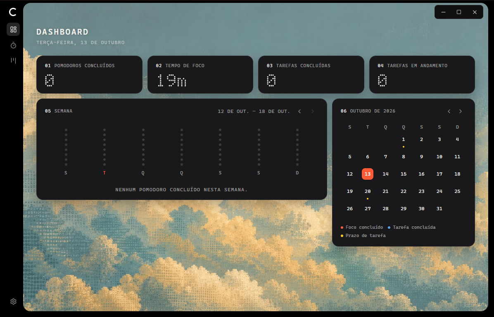

## O notch

Um pequeno puxador na borda da tela (no topo ou em uma das laterais). Ao passar o mouse, ele
se abre por cima de qualquer aplicativo; a roda do mouse troca de aba.

| Timer                                                | Tarefas                                                |
| ---------------------------------------------------- | ------------------------------------------------------ |
| 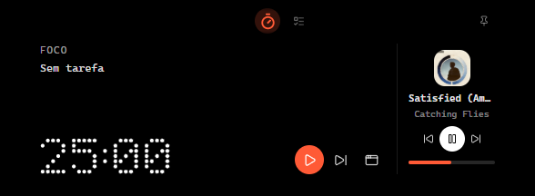   | 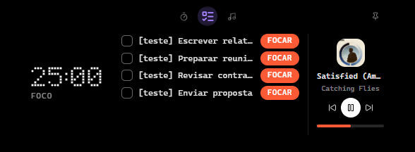 |
| **Música**                                           | **Clima**                                              |
| 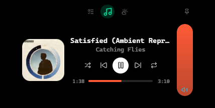 | 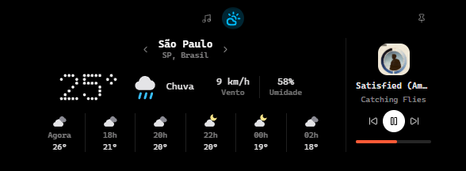     |

As capturas usam o template **Matriz**; há também o template **Vidro**, e o notch pode ser
preto, branco ou seguir o modo claro/escuro do Windows.

## Telas

| Kanban                                   | Pomodoro                                      |
| ---------------------------------------- | --------------------------------------------- |
| 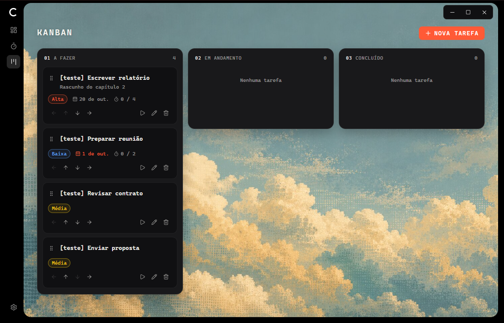 | 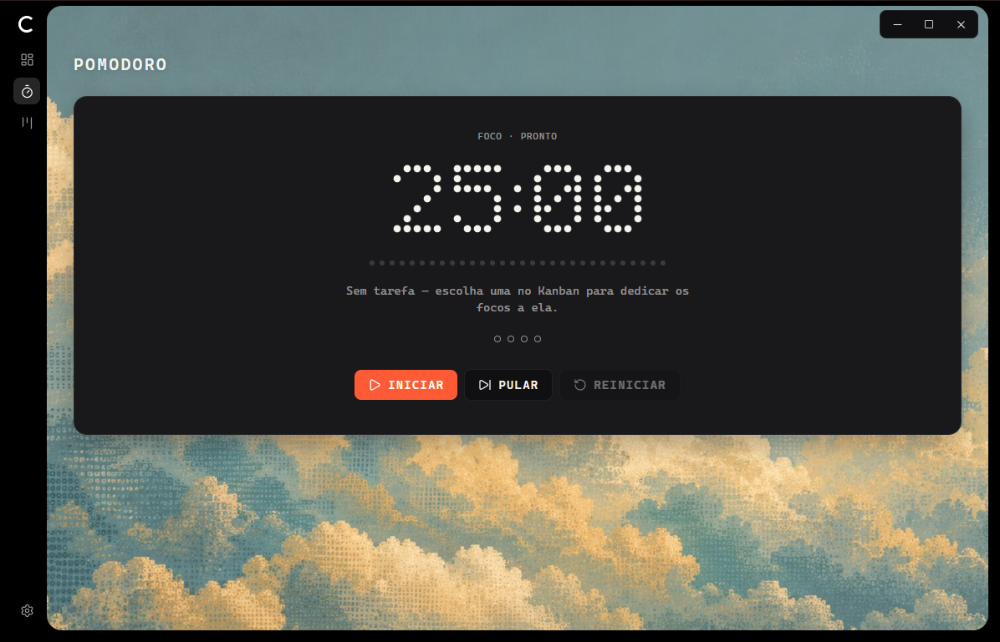 |

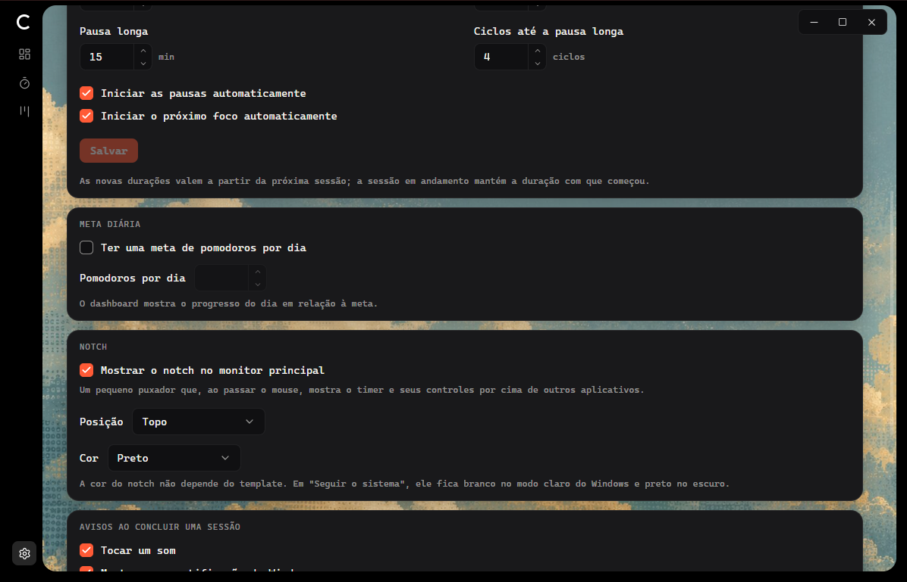

## Instalar

1. Obtenha o instalador `Compasso_<versão>_x64-setup.exe`. Ainda não há versões publicadas:
   gere o seu seguindo [Gerar o instalador](#gerar-o-instalador).
2. Execute-o. O instalador não é assinado, então o Windows SmartScreen mostra um aviso: clique
   em **Mais informações → Executar assim mesmo**.
3. Siga o assistente: apresentação, boas-vindas, licença, pasta de destino e instalação. Ele
   instala só para o seu usuário, sem pedir administrador.
4. Abra o Compasso pelo menu Iniciar.

| 1. Apresentação                                         | 2. Boas-vindas                                         | 3. Licença                                         |
| ------------------------------------------------------- | ------------------------------------------------------ | -------------------------------------------------- |
| 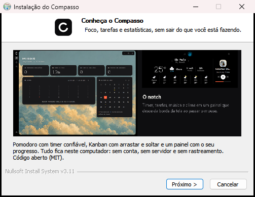 | 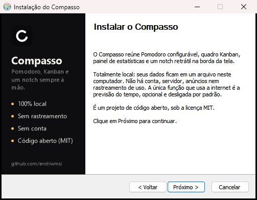 | 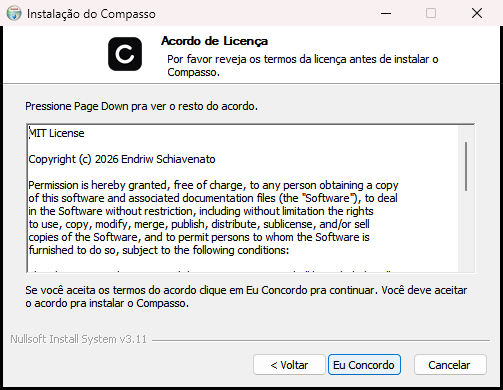 |

Para desinstalar, use **Configurações do Windows → Aplicativos**. Seus dados ficam em
`%APPDATA%\com.endriwmsi.compasso\` e não são apagados pela desinstalação.

## Primeiros passos

- **Fechar a janela não encerra o aplicativo**: ele continua na bandeja do sistema. Para sair,
  clique com o botão direito no ícone da bandeja e escolha **Encerrar**.
- **Pomodoro:** inicie um foco pela tela Pomodoro, pelo notch ou pela bandeja. As durações
  ficam em Configurações.
- **Kanban:** crie tarefas e use **Focar** para dedicar os próximos pomodoros a uma delas.
- **Notch:** em Configurações → Notch escolha a posição e a cor; a previsão do tempo é ligada
  em Configurações → Previsão do tempo.
- **Iniciar com o Windows:** Configurações → Geral.

## Pré-visualizar sem instalar

Pré-requisitos: Rust (MSVC), Build Tools do Visual Studio com C++, Node.js 24 e WebView2 —
versões em [docs/DEVELOPMENT.md](docs/DEVELOPMENT.md).

```bash
npm install
```

O aplicativo completo, com recarga automática:

```bash
npm run tauri dev
```

Só a interface, no navegador (`http://localhost:1420`; o notch fica em
`http://localhost:1420/?window=notch`). Serve para conferir o layout: timer, banco de dados,
música e clima só funcionam no aplicativo.

```bash
npm run dev
```

## Gerar o instalador

```bash
npm run tauri build
```

O arquivo sai em `src-tauri/target/release/bundle/nsis/`. Na primeira vez o empacotador baixa o
NSIS. Detalhes, inclusive como refazer as imagens do instalador, em
[docs/DEVELOPMENT.md](docs/DEVELOPMENT.md#instalador).

## Estado do projeto

Todas as fases planejadas estão implementadas; parte das verificações manuais ainda está
pendente — veja o [roadmap](docs/ROADMAP.md).

| Funcionalidade                                         | Situação                              |
| ------------------------------------------------------ | ------------------------------------- |
| Janela principal sem moldura com controles próprios    | Disponível                            |
| Navegação (Dashboard, Pomodoro, Kanban, Configurações) | Disponível                            |
| Persistência local (SQLite) e configurações            | Disponível                            |
| Templates de estilização (Vidro, Matriz)               | Disponível                            |
| Pomodoro configurável com engine em Rust               | Disponível                            |
| Notch retrátil e ícone na bandeja                      | Disponível (testes manuais pendentes) |
| Notificações e sons                                    | Disponível (testes manuais pendentes) |
| Kanban, com foco dedicado a uma tarefa                 | Disponível                            |
| Dashboard com indicadores e gráfico semanal            | Disponível                            |
| Notch: abas de música e de clima (clima opcional)      | Disponível (testes manuais pendentes) |
| Iniciar com o Windows (opcional)                       | Disponível (não verificado no login)  |
| Instalador para Windows                                | Gerado; instalação não executada      |

## Desenvolvimento

Tauri 2 · Rust · React 19 · TypeScript · Vite · Tailwind CSS v4. Detalhes e justificativas em
[ADR-001](docs/decisions/ADR-001-TECH-STACK.md).

Verificações (tipos, lint, formatação e testes de frontend e Rust):

```bash
npm run check
```

**Imagem de fundo:** coloque um arquivo `background.png` (ou `.jpg`, `.webp`, `.avif`) em
`src/assets/`. Sem ele, a janela usa um gradiente.

## Documentação

- [docs/README.md](docs/README.md) — índice.
- [AGENTS.md](AGENTS.md) — regras para quem altera o código (pessoas e agentes).
- [CHANGELOG.md](CHANGELOG.md) — histórico.
